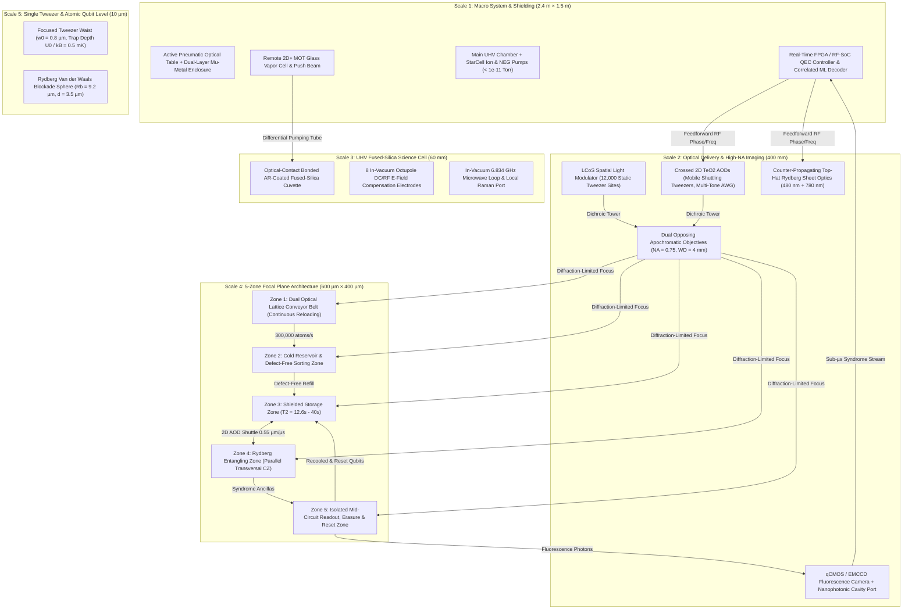

# AETHER-10K: Fault-Tolerant Zoned Neutral-Atom Quantum Computer Architecture
**Comprehensive Engineering Design & Synthesis of 2023–2026 Breakthroughs**

---

## 1. Executive Summary & Architectural Philosophy

**AETHER-10K** is a fault-tolerant, universal neutral-atom quantum processor design that synthesizes the major experimental and theoretical breakthroughs achieved between 2023 and 2026 across Harvard/QuEra, Caltech, Atom Computing/Microsoft, UChicago, and UCLA.

Historically, neutral-atom processors operated as **monolithic, pulsed ("single-shot") optical tweezer arrays**: atoms were loaded from a Magneto-Optical Trap (MOT), sorted once, subjected to global Rydberg pulses in place, and destructively or globally imaged at the end of a circuit. That monolithic paradigm faced three fundamental walls:
1. **Idling Decoherence & Crosstalk**: Qubits not participating in a gate suffered Rydberg laser tails, scattered readout photons, and differential AC Stark shifts.
2. **Finite Trap Lifetime & Pulsed Duty Cycle**: Vacuum collisions and Rydberg-state photoionization steadily depleted the array, forcing a full reload every few seconds.
3. **QEC Overhead**: Traditional surface codes required $\sim 1,000:1$ physical-to-logical ratios without erasure conversion or non-local connectivity.

**AETHER-10K** resolves all three bottlenecks through five integrated pillars:

| Pillar | Core Mechanism | Key Quantitative Metric | Primary Literature Basis |
| :--- | :--- | :--- | :--- |
| **1. 5-Zone Reconfigurable Focal Plane** | Spatial partitioning into **Conveyor**, **Reservoir/Sorting**, **Shielded Storage**, **Rydberg Entangling**, and **Mid-Circuit Readout/Reset** zones connected by 2D crossed $\text{TeO}_2$ AODs | **$22\times$ logical fidelity gain** over monolithic; coherent transport at $v = 0.55\text{ }\mu\text{m}/\mu\text{s}$ ($<10^{-4}$ motional heating loss) | *Bluvstein et al., Nature 626 (2024)*; *Bluvstein et al., Nature (2025/2026) [448-atom FT processor]*; *Lin, Tan & Cong (ZAC Compiler, 2025/2026)* |
| **2. Continuous Dual-Lattice Conveyor Reloading** | Two-stage $1064\text{ nm}$ optical lattice conveyor belts transport cold reservoirs from a remote 2D/3D MOT into the science focal plane while shielding active logical qubits | **$>300,000\text{ atoms/s}$ flux**, **$>30,000\text{ initialized qubits/s}$**, sustaining **$>3,000\text{--}10,000$ qubits continuously for $>2\text{ hours}$** | *N.-C. Chiu et al. (Lukin Group), "Continuous operation of a coherent 3,000-qubit system", Nature 646, 1075–1080 (Sept 2025)* |
| **3. High-Uniformity 12,000-Site SLM Array** | Phase-calibrated LCoS Spatial Light Modulator (SLM) + dichroic high-NA ($\text{NA} = 0.75$) apochromatic objectives supporting $>6,100$ defect-free qubits | **$T_2 = 12.6\text{ s}$** (alkali hyperfine) / **$>40\text{ s}$** ($^{171}\text{Yb}$ nuclear spin); **$99.99\%$ imaging fidelity**; $23\text{ min}$ vacuum lifetime | *H. J. Manetsch, G. Nomura, E. Bataille, M. Endres et al. (Caltech), Nature (Sept 2025)* |
| **4. Time-Optimal Rydberg Gates & Erasure Conversion** | Single-pulse phase-modulated Levine-Pichler $\text{CZ}$ gates + dual-species ($^{87}\text{Rb}$–$^{133}\text{Cs}$) or alkaline-earth ($^{171}\text{Yb}$) metastable erasure detection | **$F_{\text{CZ}} = 99.55\%$** (raw parallel) $\to$ **$99.8\%$** with heralded erasure conversion ($98\%$ of spontaneous decays converted to located erasures) | *Evered et al., Nature 622 (2023)*; *Ma et al., Nature 622 (2023)*; *Scholl et al., Nature 622 (2023)*; *Singh / Bernien et al., Science (2023)* |
| **5. High-Rate qLDPC + Surface/Color Hybrid QEC** | Reconfigurable AOD shuttling enables non-local transversal gates for $[[8,3,2]]$ color codes, $d=7$ surface codes, and $>1/2$-rate qLDPC codes with correlated ML decoding | **Encoding rate $> 1/2$** for memory blocks; **sub-threshold scaling** ($\Lambda > 2.1$); mid-circuit ancilla reset & reuse | *Bluvstein et al., Nature (2024, 2025/2026)*; *QuEra/Harvard/MIT High-Rate QEC (April 2026)*; *Microsoft & Atom Computing 28-Logical-Qubit Demo (2024–2026)* |

---

## 2. System Hierarchy & Multi-Scale Architecture

---

## 3. Detailed Subsystem Specifications

### 3.1 Vacuum & Cold-Atom Source Subsystem
- **2D$^+$ Magneto-Optical Trap (Pre-Cooler)**:
  - **Function**: Generates a high-flux ($>10^9\text{ atoms/s}$), low-velocity ($v \approx 15\text{ m/s}$) cold atomic beam from background alkali/alkaline-earth vapor ($10^{-7}\text{ Torr}$) isolated from the ultra-high-vacuum science chamber by a $1.2\text{ mm}$ diameter, $120\text{ mm}$ long low-conductance differential pumping channel.
- **UHV Fused-Silica Science Cell**:
  - **Pressure**: $< 8 \times 10^{-12}\text{ Torr}$ extreme high vacuum (XHV) maintained by a $300\text{ L/s}$ StarCell Ion Pump, Titanium Sublimation Pump (TSP), and SAES CapaciTorr Non-Evaporable Getter (NEG) cartridges.
  - **Wall Construction**: $4\text{ mm}$ thick suprasil fused-silica windows joined via hydroxide-catalysis optical contact bonding (zero outgassing epoxy), double-sided broadband V-coat and multi-wavelength anti-reflection (AR) coated ($R < 0.15\%$ at $461, 480, 556, 780, 795, 813, 852, 1064\text{ nm}$).
  - **Vacuum-Limited Atom Lifetime**: $\tau_{\text{vac}} \approx 1,380\text{ s}$ ($23\text{ minutes}$) at room temperature (*Manetsch et al., Nature 2025*).

### 3.2 Continuous Reloading Subsystem (*Chiu et al., Nature 2025*)
- **Dual Optical Lattice Conveyor Belts**:
  - **Stage A (Loading Conveyor)**: Counter-propagating $1064\text{ nm}$ high-power fiber laser beams ($P = 25\text{ W}$) with relative frequency detuning $\Delta f(t)$ controlled by dual AOMs create a moving 1D standing-wave optical lattice that captures cold atoms from a shielded reservoir MOT and translates them $4.5\text{ mm}$ into the edge of the microscope field of view.
  - **Stage B (Hand-off & Extraction Conveyor)**: Orthogonal $852\text{ nm} / 813\text{ nm}$ optical conveyor intersects Zone 1 of the focal plane, delivering $>300,000\text{ atoms/s}$.
  - **Coherence Shielding**: A spatial baffle and $780\text{ nm} / 852\text{ nm}$ light-shift compensation beam prevent scattered cooling photons from reaching the **Shielded Storage Zone** ($< 2 \times 10^{-4}$ decoherence error per reload cycle), enabling continuous $>2\text{ hour}$ steady-state quantum computation.

### 3.3 Optical Tweezer Generation & Coherent Shuttling
- **Static Tweezer Array (SLM Arm)**:
  - **Modulator**: High-power liquid-crystal-on-silicon (LCoS) Spatial Light Modulator ($1920 \times 1200$ pixels, dielectric mirror backplane for $>200\text{ W/cm}^2$ handling, water-cooled).
  - **Algorithm**: Weighted Gerchberg-Saxton (WGS) with camera-in-the-loop (CITL) aberration and intensity feedback, yielding $< 0.7\%$ trap depth standard deviation across up to **12,000 sites** (*Manetsch et al., Nature 2025*).
- **Mobile Shuttling Tweezers (Crossed 2D AOD Arm)**:
  - **Deflectors**: Pair of orthogonal shear-mode $\text{TeO}_2$ Acousto-Optic Deflectors ($42\text{ mm}$ clear aperture, $\Delta f = 50\text{ MHz}$ RF bandwidth around $85\text{ MHz}$ center frequency).
  - **RF Synthesis**: $4\text{ GS/s}$ 16-bit Arbitrary Waveform Generators (AWGs) on FPGA synthesizing $256 \times 256$ simultaneous phase-continuous cubic-spline frequency chirps ($x(t), y(t)$).
  - **Transport Kinematics**: Minimum-jerk fifth-order polynomial trajectories with average speed $v = 0.55\text{ }\mu\text{m}/\mu\text{s}$ and acceleration $a \le 0.03\text{ }\mu\text{m}/\mu\text{s}^2$, inducing $\Delta \bar{n} < 0.05$ vibrational quanta per $100\text{ }\mu\text{m}$ move (*Bluvstein et al., Nature 2022, 2024, 2026*).

### 3.4 Zoned Focal Plane Layout ($600\text{ }\mu\text{m} \times 400\text{ }\mu\text{m}$ Field of View)
The focal plane inside the UHV cuvette is divided into five spatially isolated regions:

1. **Zone 1 — Lattice Conveyor Arrival Zone ($x \in [-280, -210]\text{ }\mu\text{m}$)**:
   - Continuous arrival of cold atoms via the $1064\text{ nm}$ standing-wave conveyor belt; optical molasses cooling to $T \approx 3\text{ }\mu\text{K}$ followed by Raman sideband cooling (RSC) to the 3D motional ground state ($\bar{n}_{x,y,z} < 0.08$).
2. **Zone 2 — Reservoir & Defect-Free Sorting Zone ($x \in [-210, -100]\text{ }\mu\text{m}$)**:
   - $2,000+$ buffer tweezers stochastically loaded at $50\%\text{--}60\%$ (collisional blockade) or $82\%$ (blue-detuned $\Lambda$-enhanced gray molasses), then compressed in $< 15\text{ ms}$ via parallel row/column AOD sweeps into defect-free supply blocks.
3. **Zone 3 — Shielded Storage Zone ($x \in [-100, +60]\text{ }\mu\text{m}$)**:
   - Holds idling logical qubit patches (e.g., $d=7$ surface code patches, $[[8,3,2]]$ 3D color-code blocks, or $[[144,12,12]]$ bivariate bicycle qLDPC blocks) at $5\text{ }\mu\text{m}$ inter-atom spacing.
   - Spectrally and spatially shielded from Rydberg UV/blue beams and readout fluorescence; dynamical decoupling (XY8 / Carr-Purcell-Meiboom-Gill microwave or Raman sequences) extends coherence to $T_2 = 12.6\text{ s}$ ($^{133}\text{Cs}$/$^{87}\text{Rb}$) or $>40\text{ s}$ ($^{171}\text{Yb}$ nuclear spin).
4. **Zone 4 — Rydberg Entangling Zone ($x \in [+60, +180]\text{ }\mu\text{m}$)**:
   - Active logical patches are shuttled in pairs to $d = 3.2\text{--}3.8\text{ }\mu\text{m}$ inter-atom separation (well inside the Rydberg blockade radius $R_b = (C_6 / \hbar \Omega)^{1/6} \approx 9.2\text{ }\mu\text{m}$ for $n = 53S_{1/2}$ or $61S_{1/2}$).
   - Illuminated by counter-propagating flat-top cylindrical light sheets ($480\text{ nm}$ blue + $780\text{ nm}$ IR two-photon for $^{87}\text{Rb}$; or single-photon $302\text{ nm}$ from intracavity-doubled Ti:Sapphire for $^{171}\text{Yb}$).
   - **Time-Optimal Single-Pulse $\text{CZ}$ Gate**: Smooth sinusoidal phase profile $\phi(t) = A \cos(\omega t + \varphi_0) + \delta_0 t$ (*Evered et al., Nature 2023*) completes a parallel $\text{CZ}$ gate across all paired qubits in $\tau_{\text{gate}} = 240\text{ ns}$ with **$F_{\text{CZ}} = 99.55\%$** (and **$99.8\%$** with erasure post-selection).
5. **Zone 5 — Isolated Mid-Circuit Readout, Erasure & Reset Zone ($x \in [+180, +280]\text{ }\mu\text{m}$)**:
   - Ancilla qubits (or logical teleportation patches) are shuttled into Zone 5 (or read out in-situ via $^{133}\text{Cs}$ dual-species selective $852\text{ nm}$ excitation).
   - Fast $150\text{ }\mu\text{s}$ low-loss fluorescence imaging onto a back-illuminated qCMOS camera ($99.99\%$ state discrimination) + fast $5\text{ }\mu\text{s}$ erasure-check flash on the metastable decay transition.
   - Measured ancillas are optically pumped, Raman-sideband recooled, and **reused mid-circuit** or swapped with fresh atoms from Zone 2.

---

## 4. Supported Species Configurations (Selectable in 3D Model)

| Parameter | Config A: Hybrid Dual-Species Alkali (Default) | Config B: Alkaline-Earth Nuclear Spin | Config C: Ultra-Scale Single-Species Alkali |
| :--- | :--- | :--- | :--- |
| **Atomic Species** | $^{87}\text{Rb}$ (Data) + $^{133}\text{Cs}$ (Ancilla) | $^{171}\text{Yb}$ ($I = 1/2$ Nuclear Spin) | $^{133}\text{Cs}$ (High Polarizability) |
| **Qubit Encoding** | Clock hyperfine $\lvert F=1, m_F=0\rangle, \lvert F=2, m_F=0\rangle$ | Metastable $^3P_0$ nuclear spin $\lvert m_I = \pm 1/2\rangle$ | Clock hyperfine $\lvert F=3, m_F=0\rangle, \lvert F=4, m_F=0\rangle$ |
| **Tweezer Wavelength** | $813\text{ nm}$ (Rb) & $935\text{ nm}$ (Cs) magic/low-crosstalk | $759\text{ nm}$ / $532\text{ nm}$ magic wavelength | $1064\text{ nm}$ / $852\text{ nm}$ high-power |
| **Rydberg Excitation** | $780\text{ nm} + 480\text{ nm}$ (Rb), $852\text{ nm} + 509\text{ nm}$ (Cs) | $302\text{ nm}$ single-photon ($^3P_0 \to 55\text{--}71\text{ }^3S_1$) | $459\text{ nm} + 1038\text{ nm}$ inverted two-photon |
| **Coherence Time ($T_2$)** | $4.5\text{ s}$ (Rb) / $12.6\text{ s}$ (Cs) | $> 40\text{ s}$ (zero magnetic moment $J=0$) | **$12.6\text{ s}$** (*Manetsch et al., 2025*) |
| **2-Qubit $\text{CZ}$ Fidelity** | $99.55\%$ (intraspecies), $99.3\%$ (interspecies) | $99.5\%$ raw $\to$ **$99.8\%$ erasure-converted** | $99.5\%$ |
| **Reference** | *Bluvstein 2024/2026*; *Singh & Bernien 2023* | *Ma et al. 2023*; *Atom Computing / Microsoft 2024–2026* | *Manetsch / Endres et al., Nature 2025* |

---

## 5. Key Literature & Experimental Foundations (2023–2026)

1. **D. Bluvstein et al. (Harvard / QuEra / MIT)**, *"Logical quantum processor based on reconfigurable atom arrays"*, **Nature 626**, 58–65 (2024). Demonstrated 48 logical qubits, transversal entangling gates, and zoned architecture across storage, entangling, and readout zones.
2. **D. Bluvstein et al. (Harvard / QuEra / MIT)**, *"A fault-tolerant neutral-atom architecture for universal quantum computation"*, **Nature** (2025/2026). Demonstrated 448-atom universal fault-tolerant processing, repeated below-threshold surface-code QEC cycles, mid-circuit qubit reset/reuse, and correlated ML + erasure decoding.
3. **N.-C. Chiu et al. (Harvard Lukin Group)**, *"Continuous operation of a coherent 3,000-qubit system"*, **Nature 646**, 1075–1080 (Sept 2025). Demonstrated continuous reloading at $300,000\text{ atoms/s}$ ($>30,000\text{ qubits/s}$) via dual optical lattice conveyor belts, maintaining $>3,000$ coherent qubits for $>2\text{ hours}$.
4. **H. J. Manetsch, G. Nomura, E. Bataille, M. Endres et al. (Caltech)**, *"A tweezer array with 6,100 highly coherent atomic qubits"*, **Nature** (Sept 2025). Demonstrated 6,100 $^{133}\text{Cs}$ qubits in $\sim 12,000$ sites with $T_2 = 12.6\text{ s}$, $99.99\%$ imaging fidelity, and $23\text{ min}$ room-temperature survival.
5. **S. J. Evered et al. (Harvard / QuEra)**, *"High-fidelity parallel entangling gates on a neutral-atom quantum computer"*, **Nature 622**, 268–272 (2023). Achieved $99.5\%$ two-qubit $\text{CZ}$ gate fidelity across 60 parallel qubits using single-pulse optimal control.
6. **S. Ma et al. (Princeton / Thompson Group)**, *"High-fidelity gates and mid-circuit erasure conversion in an atomic array"*, **Nature 622**, 279–284 (2023) & **P. Scholl et al. (Caltech / Endres Group)**, *"Erasure conversion in a high-fidelity Rydberg quantum simulator"*, **Nature 622**, 273–278 (2023).
7. **K. Singh, C. E. Bradley, S. Anand, H. Bernien et al. (UChicago)**, *"Mid-circuit operations using the omg-architecture in a dual-speciesrydberg array"*, **Science 380**, 1265–1269 (2023) & interspecies Rydberg gates (2024–2025).
8. **Microsoft & Atom Computing**, *"Demonstration of 24 entangled logical qubits and 28-logical-qubit fault-tolerant computation in neutral Yb-171 arrays"* (Nov 2024 – 2026 "Magne" commercial deployment).
9. **B. Lin, B. Tan, J. Cong (UCLA)**, *"ZAC: Reuse-Aware Compilation for Zoned Quantum Architectures"*, **ASPLOS / IEEE** (2025/2026). Demonstrated up to $22\times$ circuit fidelity improvement via zoned storage shielding and AOD routing optimization.
10. **QuEra, Harvard & MIT Collaboration**, *"High-Rate Fault-Tolerant Quantum Error Correction with >1/2 Encoding Rate in Reconfigurable Neutral-Atom Arrays"* (April 2026) & *"Strategic Plan for Neutral Atom Quantum Computation"* (*arXiv:2607.21554*, July 2026).
